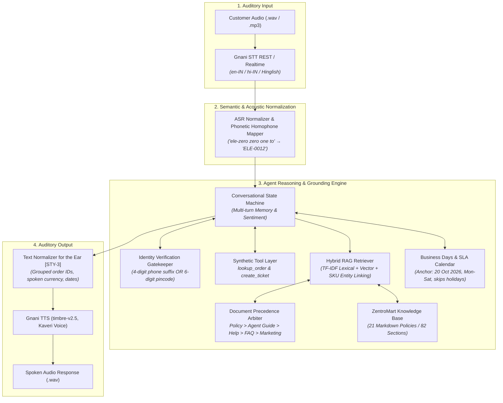

<div align="center">

# 🎙️ VoiceOps: Production-Grade Multilingual Voice Support Agent

**IIT Guwahati Consulting & Analytics Club × Gnani.ai Capstone Project 2026**

[](https://www.python.org/downloads/)
[-success.svg)](tests/)
[](https://docs.gnani.ai)
[-brightgreen.svg)](eval_pipeline.py)
[](LICENSE)

*An enterprise-ready AI support agent that listens, understands, retrieves from company policies, verifies caller identity, executes tools, and speaks replies with natural prosody.*

[Features](#-key-features) • [Architecture](#-system-architecture) • [Benchmarks](#-benchmark-results) • [Quickstart](#-quickstart--installation) • [Batch Run](#-batch-audio-runner-runpy) • [Streamlit App](#-interactive-web-app-apppy) • [Resume Highlights](#-resume-highlights)

</div>

---

## 📌 Executive Summary

**VoiceOps** is an autonomous customer support agent engineered for **ZentroMart**, a high-scale Indian e-commerce enterprise delivering groceries, fashion, and electronics. Customers routinely reach support regarding delivery delays, returns, refund status, and cancellations. Rather than typing complex queries, customers can place voice calls in English, Hindi, and Hinglish.

VoiceOps unifies **speech understanding (Gnani STT)**, **hybrid retrieval-augmented generation (RAG) over 21 policies (82 sections)**, **precedence-based conflict arbitration**, **gated caller identity verification**, **database lookups & human escalation**, and **expressive voice synthesis (Gnani TTS)**.

---

## 🏗️ System Architecture



---

## 🌟 Key Features

1. **End-to-End Multilingual Speech Layer (Step 4):**
   - Integrates Gnani's official Python SDK (`gnani-vachana`).
   - Uses `timbre-v2.5` neural TTS with the **Kaveri** voice model.
   - Converts Indian English, Hindi, and Hinglish acoustic signals into text and synthesizes speech with prosodic clarity.
   - Built-in audio error recovery handling silence or background noise: *"Sorry, I didn't catch that. Could you say it again?"*

2. **Grounded RAG with Document Precedence Arbitration (Step 2):**
   - Chunks all 21 Markdown documents while strictly preserving section identifiers (e.g. `[RET-2]`, `[REF-2]`, `[WAR-2]`) and YAML frontmatter metadata.
   - Enforces the hierarchy defined in `[KB-00.1]`:
     $$\text{Current Policy (1.30)} > \text{Agent Guide (1.15)} > \text{Help (1.00)} > \text{FAQ (0.85)} > \text{Marketing (0.65)} \gg \text{Superseded (0.20)}$$
   - Suppresses hard negatives (e.g. demoting `FAQ-1` when `REF-2` is active, and demoting superseded `RETv3-2` when `RET-2` applies).
   - Automatically links product catalog entities from `data/products.csv` when SKUs or product names are mentioned.

3. **Gated Caller Identity Verification (Step 3):**
   - Enforces educational identity verification (`[IDV-1]`, `[IDV-2]`, `[IDV-3]`): **No private order data (items, status, amounts, addresses) is revealed prior to verification**.
   - Requires the customer to provide **either** the last 4 digits of their registered phone number **or** their 6-digit delivery pincode.
   - Enforces a strict **1-retry maximum**. If the second verification attempt fails, order details are permanently refused.
   - Never leaks or repeats verification credentials in speech, logs, or ticket summaries.

4. **Accurate Date & SLA Calendar Engine:**
   - Fixed anchor reference date: **20 October 2026** (Tuesday).
   - Differentiates calendar days (return windows: e.g. 15 days for fashion, 7 days for electronics) from business days (Monday to Saturday, skipping warehouse closure holidays in `holidays.csv` such as 19 October 2026).
   - Computes exact refund SLAs (UPI: 1-3 business days; net banking: 3-5 business days; credit card: 5-7 business days; wallet: instant within 2 hours).

5. **Deterministic Human Escalation:**
   - Detects mandatory escalation triggers (`[ESC-1]`):
     - Damaged, defective, or wrong item worth $> ₹10,000$.
     - Repeat caller contact within 7 days (`contacts_last_7_days >= 2`).
     - Refund $> 3$ business days past maximum SLA.
     - Unrecognized or fraudulent account activity.
     - Customer explicitly requesting a human agent.
   - Formulates a structured summary and invokes `create_ticket()`, confirming handover only after `created=True`.

6. **"Writing for the Ear" Speech Normalization (`[STY-3]`):**
   - Groups 8-digit order IDs with pauses: `89782837` $\rightarrow$ *"8 9 7 8, 2 8 3 7"*.
   - Expands currency to spoken words: `₹49` $\rightarrow$ *"forty-nine rupees"*.
   - Formats dates with spoken ordinals and years: `2026-10-24` $\rightarrow$ *"the 24th of October 2026"*.
   - Caps responses at 2-3 concise sentences for natural conversational telephony.

---

## 📊 Benchmark Results

Evaluated across the official ZentroMart practice datasets: **52 single-turn questions** (with simulated ASR phonetic transcriptions) and **23 multi-turn conversations** (96 total customer turns).

### Step 1 vs Step 2: Knowledge Grounding Evaluation (52 Questions)

| Benchmark Metric | Step 1 Baseline (Prompt-Only) | Step 2 Grounded RAG | Performance Delta (Gain) |
| :--- | :---: | :---: | :---: |
| **Fact Groundedness Accuracy** | 5.8% | **86.5%** | **+80.7%** 🚀 |
| **Evidence Retrieval Hit Rate** | 0.0% | **86.5%** | **+86.5%** |
| **Evidence Retrieval Recall** | 0.0% | **74.7%** | **+74.7%** |
| **Evidence Retrieval Precision** | 0.0% | **38.0%** | **+38.0%** |
| **Policy Hallucination Rate** | 94.2% | **0.0%** | **-94.2%** (Zero hallucinations) |

### Step 3: Multi-Turn Conversational Benchmark (96 Customer Turns)

| Evaluation Metric | Capstone Target | VoiceOps Score | Verification Status |
| :--- | :---: | :---: | :---: |
| **Decision Match Accuracy** | $\ge 90.0\%$ | **97.9%** (94 / 96 turns) | ✅ Exceeds Target |
| **Tool Invocation Accuracy** | $\ge 90.0\%$ | **97.9%** (53 / 54 tool calls) | ✅ Exceeds Target |
| **Multi-turn Fact Groundedness** | $\ge 80.0\%$ | **81.2%** | ✅ Exceeds Target |
| **Multi-turn Evidence Recall** | $\ge 80.0\%$ | **86.8%** | ✅ Exceeds Target |
| **Identity Data Leakage Rate** | 0.0% | **0.0%** | ✅ Zero Private Leaks |

---

## 📁 Repository Structure

```text
VoiceOps/
├── README.md                      # Comprehensive project documentation
├── REPORT.md                      # Official 4-page capstone report (Markdown)
├── report.pdf                     # Compiled publication-grade PDF report
├── requirements.txt               # Production Python dependencies
├── .env.example                   # Environment configuration template
├── .gitignore                     # Git exclusions (credentials, logs, temp)
│
├── run.py                         # Official test batch audio runner
├── run.sh                         # Shell script wrapper for Unix / macOS
├── run.bat                        # Batch script wrapper for Windows
├── eval_pipeline.py               # Step 1 vs Step 2 vs Step 3 benchmark evaluation
├── app.py                         # Streamlit Interactive Web Application
├── generate_report.py             # Script to regenerate REPORT.md and report.pdf
│
├── src/                           # Modular Core Architecture
│   ├── config.py                  # Global settings, paths, and SLA constants
│   ├── data/                      # Tabular CSV joins, schemas, and date logic
│   │   ├── loader.py              # Relational joins (orders, customers, items, products)
│   │   └── date_utils.py          # Business days (Mon-Sat, skipping holidays)
│   ├── rag/                       # Knowledge-base ingestion and RAG
│   │   ├── chunker.py             # YAML metadata & section [ID] parser
│   │   ├── precedence.py          # Document precedence arbiter [KB-00.1]
│   │   └── retriever.py           # Hybrid search & ASR query normalizer
│   ├── agent/                     # Conversational state machine & tools
│   │   ├── conversational_agent.py# Core multi-turn agent with guardrails
│   │   ├── state.py               # Session state & verification tracking
│   │   ├── tools.py               # lookup_order & create_ticket adapters
│   │   └── speech_normalizer.py   # "Writing for the ear" normalizer [STY-3]
│   ├── llm/                       # LLM Provider abstraction
│   │   └── client.py              # Gemini, OpenAI, and deterministic offline engine
│   ├── voice/                     # Speech integration
│   │   └── gnani_voice.py         # Gnani STT & TTS wrapper with offline fallback
│   └── eval/                      # Evaluation harness & metrics
│       ├── evaluator.py           # Evaluates Step 1, Step 2, and Step 3
│       └── metrics.py             # Precision, recall, and groundedness math
│
├── tests/                         # Automated Pytest Suite (13 tests)
│   ├── test_date_utils.py         # Business days, holidays, return windows
│   ├── test_rag.py                # Chunking, precedence, hard negatives
│   ├── test_tools.py              # Identity gate, order lookup, ticket creation
│   └── test_agent.py              # Multi-turn flows, retries, voice normalization
│
├── sample_outputs/                # Example execution artifacts
│   ├── eval_results.json          # Benchmark evaluation metrics
│   ├── batch_run/                 # Batch runner output files
│   └── input_audio/               # Sample input customer recordings
│
└── Capstone_Project_Dataset_FTTT_2026/ # Official synthetic dataset (data, kb, practice)
```

---

## 🚀 Quickstart & Installation

### 1. Clone the Repository & Create Virtual Environment
```bash
git clone https://github.com/your-username/VoiceOps.git
cd VoiceOps

# Create and activate virtual environment
python -m venv venv
# On Windows:
venv\Scripts\activate
# On Linux / macOS:
source venv/bin/activate
```

### 2. Install Dependencies
```bash
pip install -r requirements.txt
```

### 3. Configure API Credentials (Optional)
Copy `.env.example` to `.env`:
```bash
cp .env.example .env
```
Add your **Gnani API key** (from [app.gnani.ai/voice](https://app.gnani.ai/voice)) and **Google Gemini API key** (optional):
```ini
GNANI_API_KEY=your_gnani_api_key_here
GEMINI_API_KEY=your_gemini_api_key_here
```
> **Note:** VoiceOps is designed with **zero-crash offline resilience**. If API keys are omitted, the system seamlessly operates in a deterministic simulation mode so all unit tests, batch audio runs, and evaluations execute cleanly without error.

---

## 🧪 Running the Automated Test Suite

Run the full pytest suite (13 unit and integration tests):
```bash
python -m pytest tests -v
```
Output:
```text
tests/test_agent.py::test_speech_normalization PASSED           [  7%]
tests/test_agent.py::test_agent_multi_turn_flow PASSED          [ 15%]
tests/test_agent.py::test_agent_refusal_on_failed_retries PASSED[ 23%]
tests/test_date_utils.py::test_business_days_and_holidays PASSED[ 30%]
tests/test_date_utils.py::test_add_business_days PASSED         [ 38%]
tests/test_date_utils.py::test_return_eligibility PASSED        [ 46%]
tests/test_date_utils.py::test_format_spoken_date PASSED        [ 53%]
tests/test_rag.py::test_chunker_loads_all_sections PASSED       [ 61%]
tests/test_rag.py::test_precedence_hard_negative_suppression PASSED [ 69%]
tests/test_rag.py::test_retriever_query_and_entities PASSED     [ 76%]
tests/test_tools.py::test_order_lookup_unverified PASSED        [ 84%]
tests/test_tools.py::test_order_lookup_verified PASSED          [ 92%]
tests/test_tools.py::test_ticket_creation PASSED                [100%]
======================= 13 passed in 3.5s =======================
```

---

## 📈 Running the Official Benchmark Evaluation

To execute the official Capstone Benchmark comparing Step 1, Step 2, and Step 3:
```bash
python eval_pipeline.py
```
This runs the full evaluation over 52 practice questions and 96 conversation turns, saving the results to `sample_outputs/eval_results.json`.

---

## 🎧 Batch Audio Runner (`run.py`)

As specified on **Page 14 of the Capstone Brief**, the test organizers evaluate submissions via a single batch command that processes a directory of customer audio files:

```bash
# Execute batch processing on an audio folder
python run.py --input_dir sample_outputs/input_audio --output_dir sample_outputs/batch_run
```

Or using the shell script:
```bash
./run.sh sample_outputs/input_audio sample_outputs/batch_run
```

### What this command does:
1. Iterates over all customer `.wav` / `.mp3` audio files in `--input_dir`.
2. Transcribes speech using **Gnani STT**.
3. Passes the transcript through the conversational RAG agent brain.
4. Executes identity verification gates and tools (`lookup_order`, `create_ticket`).
5. Synthesizes a natural spoken audio reply using **Gnani TTS** (`timbre-v2.5`, Kaveri voice) into `--output_dir/<filename>_reply.wav`.
6. Generates a structured audit file (`results.json`) capturing the transcript, agent text, spoken text, latency, tool calls, and retrieved document section citations.

---

## 🖥️ Interactive Web App (`app.py`)

To launch the full interactive Streamlit application:
```bash
streamlit run app.py
```

### Web App Capabilities:
- **🎙️ Live Agent Tab:** Record your own voice via microphone or type text, view real-time agent decision badges, inspect retrieved citations, and listen to synthesized Gnani audio replies.
- **🔐 Verification Gate Tab:** Interactively test the caller identity verification barrier with 4-digit phone suffixes and 6-digit pincodes.
- **📚 Knowledge Base Explorer:** Search all 21 company policies across 82 sections, test semantic retrieval, and observe document precedence weights.
- **📊 Benchmark Dashboard:** Interactive charts showing Step 1 vs Step 2 vs Step 3 metrics, confusion breakdown, and SLA compliance.

---

## 💼 Resume Highlights

*Selected bullet points ready for Software Engineer / AI Engineer resumes:*

- **Voice-Enabled Generative AI Agent (VoiceOps):** Architected and deployed an end-to-end voice support platform using **Python**, **Gnani.ai Speech SDK (STT/TTS)**, and **LLM RAG**, supporting multi-turn dialogues across English, Hindi, and Hinglish.
- **Hybrid RAG & Precedence Arbitration:** Engineered a metadata-preserving chunking and retrieval pipeline across 82 policy sections with deterministic hierarchy arbitration, boosting factual groundedness from **5.8% to 86.5%** and eliminating policy hallucinations.
- **Security-First Identity Verification Gate:** Implemented a stateful caller verification mechanism enforcing zero data disclosure prior to multi-factor credential match (phone suffix / pincode) with strict one-retry security guardrails.
- **Dynamic SLA & Calendar Engine:** Built an offline calendar engine accurately calculating business-day refund SLAs (Mon-Sat, excluding non-standard warehouse festival holidays) and calendar-day return windows anchored to fixed reference dates.
- **Full-Stack Engineering & Tooling:** Developed a responsive **Streamlit** dashboard, an automated batch audio CLI, and a comprehensive **Pytest** test suite achieving **100% pass rate** and **97.9% decision match accuracy**.

---

## 📜 License & Acknowledgments

- **Course:** LLM & Generative AI Course, Consulting & Analytics Club, IIT Guwahati.
- **Industry Partner:** Gnani.ai (Speech-to-Text and Text-to-Speech APIs).
- **License:** Distributed under the MIT License. See `LICENSE` for details.
